<div align="center">


# Amine Mabrouk

**Software engineer in Tunis.** I ship full-stack products — schemas, APIs, UI, automated deploys, and keeping them up when traffic hits.

[Portfolio](https://my-portfolio-seven-chi-94.vercel.app) · [Email](mailto:amx72001@gmail.com) · [LinkedIn](https://www.linkedin.com/in/amine-mabrouk) · [GitHub](https://github.com/AmineMabrouk17)


</div>

---

### What I actually do

I build products end-to-end. Not "I touched the frontend once" — I mean I design the schema, write the migrations, ship the API contract, build the UI, configure the CI/CD pipeline, and ensure it runs reliably in production.

Day-to-day: **TypeScript / Next.js**, **Angular**, **Laravel**, **Python**. I care about the boring parts that make software real — schemas that don't fall over under real data, auth that's actually secure (not "I'll add JWT and call it a day"), and features that work the moment a user clicks them, not three sprints later.

I also ship things other people install, not just things they visit — an MIT GitHub Action, a Markdown-to-PDF resume tool, a legal RAG that answers in Arabic with citations.

I use AI every day. I'm not pretending otherwise. But I decide what gets abstracted, what gets tested, and where the security boundary lives — not the model.

---

### Currently

- **Building** — [Crypto & Stocks Dashboard](https://crypto-stocks-web-taupe.vercel.app), a real-time market terminal with Binance WS streaming, multi-provider AI chat, and crowd-sourced price predictions.
- **Maintaining** — [telegram-ci-notify](https://github.com/AmineMabrouk17/telegram-ci-notify), a dependency-free GitHub Actions → Telegram action, versioned and CI-tested.
- **Learning** — by building. Every project I ship teaches me more than a tutorial ever did. My study plan is just a repo, a deploy, and a problem I haven't solved yet.
- **Opinionated about** — Cloudflare Workers + D1 for small-to-medium apps. Most teams reach for a bloated VPS and Postgres server when a 50ms edge worker does the same job at 1/10th the complexity.

---

### Shipped work

These aren't demo repos. Each one is live, deployed to production, and the source code is public.

<table width="100%">
  <tr>
    <td width="50%" valign="top">
      <h3>📈 Crypto & Stocks Dashboard</h3>
      <p><i>The thing I'm most proud of.</i></p>
      <p>Real-time market intelligence terminal — Binance WebSocket streaming, Yahoo Finance quotes, TradingView-style charts, browser-native price alerts, and a multi-provider AI chat assistant (Gemini · Groq · OpenAI · Anthropic) so you're not locked into one vendor.</p>
      <p><code>Next.js</code> · <code>WebSocket</code> · <code>lightweight-charts</code> · <code>SWR</code> · <code>Turborepo</code></p>
      <p>
        <a href="https://crypto-stocks-web-taupe.vercel.app"></a>
        &nbsp;
        <a href="https://github.com/AmineMabrouk17/crypto-stocks"></a>
      </p>
    </td>
    <td width="50%" valign="top">
      <h3>⚖️ MustacharAI</h3>
      <p><i>Legal answers in Arabic, grounded in the actual codes.</i></p>
      <p>RAG assistant over ~15 Tunisian legal codes — roughly 3,500 indexed articles. Answers in Arabic or Darija, cites the article it used, takes and speaks voice, and lets you bring your own provider (Groq · Gemini · OpenRouter key set from the UI).</p>
      <p><code>FastAPI</code> · <code>ChromaDB</code> · <code>sentence-transformers</code> · <code>Next.js</code> · <code>RTL</code></p>
      <p>
        <a href="https://mustachar-ai.vercel.app"></a>
        &nbsp;
        <a href="https://github.com/AmineMabrouk17/MustacharAI"></a>
      </p>
    </td>
  </tr>
  <tr>
    <td width="50%" valign="top">
      <h3>🎬 Cast n Cue</h3>
      <p><i>Because Trakt's UX makes me angry.</i></p>
      <p>Episode-level watchlist running on edge architecture. TMDB/Trakt search, half-star ratings, private autosaved notes, and a watchlist roulette for when you can't decide what to start next.</p>
      <p><code>Next.js</code> · <code>Cloudflare Workers</code> · <code>Cloudflare D1</code> · <code>Better Auth</code></p>
      <p>
        <a href="https://cast-cue.cast-cue.workers.dev"></a>
        &nbsp;
        <a href="https://github.com/AmineMabrouk17/Cast-Cue"></a>
      </p>
    </td>
    <td width="50%" valign="top">
      <h3>💰 BudgetIQ</h3>
      <p><i>Open-source, AI-native, actually usable.</i></p>
      <p>Budget planner where a conversational Gemini assistant turns "I spent 12 dinars on coffee" into a logged transaction and an updated dashboard. No tedious forms. No friction.</p>
      <p><code>Next.js</code> · <code>Supabase</code> · <code>Gemini AI</code> · <code>Recharts</code></p>
      <p>
        <a href="https://budgetiq-two.vercel.app"></a>
        &nbsp;
        <a href="https://github.com/AmineMabrouk17/BudgetIQ"></a>
      </p>
    </td>
  </tr>
  <tr>
    <td width="50%" valign="top">
      <h3>🎮 GameStore TN</h3>
      <p><i>Built for the Tunisian gaming scene.</i></p>
      <p>Marketplace for gaming accounts — PES/eFootball, Free Fire, and more — with secure listings and checkout. Built local-first to solve payment and verification issues for regional gamers.</p>
      <p><code>Next.js</code> · <code>Cloudflare Workers</code> · <code>PostgreSQL</code> · <code>Tailwind</code></p>
      <p>
        <a href="https://gamestore-tn.cast-cue.workers.dev"></a>
        &nbsp;
        <a href="https://github.com/AmineMabrouk17/GameStore-TN"></a>
      </p>
    </td>
    <td width="50%" valign="top">
      <h3>🛒 Lumina — E-Commerce Storefront</h3>
      <p><i>The full storefront, not the demo version.</i></p>
      <p>Catalog, cart, Stripe Checkout, verified reviews, and admin order fulfillment. Complete end-to-end commerce architecture backed by relational PostgreSQL data models.</p>
      <p><code>Next.js</code> · <code>Supabase</code> · <code>Stripe</code> · <code>PostgreSQL</code> · <code>Zustand</code></p>
      <p>
        <a href="https://ecommerce-website-puce-beta.vercel.app/"></a>
        &nbsp;
        <a href="https://github.com/AmineMabrouk17/ecommerce-website"></a>
      </p>
    </td>
  </tr>
  <tr>
    <td width="50%" valign="top">
      <h3>📄 Resumark</h3>
      <p><i>Markdown in, ATS-safe A4 PDF out.</i></p>
      <p>Resume editor that keeps your source as plain Markdown: live A4 preview, template switcher, an optional forced one-page mode, and print-native PDF export. No account, no lock-in — the file stays yours.</p>
      <p><code>Next.js</code> · <code>Markdown</code> · <code>Print CSS</code> · <code>Local persistence</code></p>
      <p>
        <a href="https://resumark-eight.vercel.app"></a>
        &nbsp;
        <a href="https://github.com/AmineMabrouk17/Resumark"></a>
      </p>
    </td>
    <td width="50%" valign="top">
      <h3>⛓️ TrustlessEscrow</h3>
      <p><i>Side experiment in on-chain dispute arbitration.</i></p>
      <p>Trust-minimized escrow state machine deployed on Sepolia. Explores smart contract state transitions, buyer/seller fund locking, and third-party arbiter resolution.</p>
      <p><code>Solidity</code> · <code>Foundry</code> · <code>wagmi</code> · <code>viem</code></p>
      <p>
        <a href="https://trustless-escrow-demo.vercel.app"></a>
        &nbsp;
        <a href="https://github.com/AmineMabrouk17/nextjs-solidity-escrow"></a>
      </p>
    </td>
  </tr>
</table>

---

### Open source

**[telegram-ci-notify](https://github.com/AmineMabrouk17/telegram-ci-notify)** — GitHub Actions → Telegram in one composite action. MIT, ~250 lines of `bash` + `curl`, no third-party action to trust and nothing to install. Pushes, PRs, reviews, comments, tags and releases arrive as one compact message with buttons back to GitHub, and a notification failure warns instead of turning a green build red.

```yaml
- uses: AmineMabrouk17/telegram-ci-notify@v1
  env:
    TELEGRAM_TOKEN: ${{ secrets.TELEGRAM_TOKEN }}
    TELEGRAM_TO: ${{ secrets.TELEGRAM_TO }}
```

`shellcheck` · `actionlint` · offline test suite · offline dry-run — all green on every push.

---

### Also built

| Project | What it is |
|---|---|
| [Silo](https://silo-umber.vercel.app) | Dual-phase compound interest & retirement drawdown calculator in TND — [source](https://github.com/AmineMabrouk17/Silo) |
| [ThinkCode](https://github.com/AmineMabrouk17/ThinkCode) | Workspace for learning algorithms: keep the reasoning, not just the accepted solution |
| [nanobrowser-free-ai](https://github.com/AmineMabrouk17/nanobrowser-free-ai) | A free, private AI browser agent setup — honest notes on what works and what doesn't |
| [curator-studio](https://github.com/AmineMabrouk17/curator-studio) | Next.js + Cloudflare content curation studio |
| [gotn-shop](https://github.com/AmineMabrouk17/gotn-shop) | Go store scraper with a pluggable `StoreScraper` per retailer |
| [LinkedIn-Job-Description-Copier](https://github.com/AmineMabrouk17/LinkedIn-Job-Description-Copier) | Small extension that copies a job post as clean text |
| [ExportLLMExtension](https://github.com/AmineMabrouk17/ExportLLMExtension) | Export your LLM conversations instead of re-typing them |
| [text2excalidraw](https://github.com/AmineMabrouk17/text2excalidraw) | Describe a diagram, get an editable Excalidraw scene |
| [lead-generation-landing-page](https://github.com/AmineMabrouk17/lead-generation-landing-page) | Astro landing page built for conversion, not for a template gallery |
| [My-Portfolio](https://github.com/AmineMabrouk17/My-Portfolio) | The site behind the link at the top of this page |

---

### What I reach for

Not a generic "skills list" — the actual tools I pick when starting a new build.

| For | I'd use | Why |
|---|---|---|
| Edge-hosted web app | **Next.js + Cloudflare Workers** | Sub-50ms cold starts without running expensive server instances |
| Heavy backend & queues | **Laravel** | Life is too short to write custom queue & ORM boilerplate |
| Fast APIs & Data scripts | **Python / Flask** | Lightweight, minimal overhead, straight to the logic |
| Retrieval over documents | **FastAPI + ChromaDB + sentence-transformers** | Citations are a feature, and the vector store should not be a black box |
| Real-time dashboards | **WebSocket + SWR + lightweight-charts** | Polling is an anti-pattern for live market data |
| Relational data & auth | **PostgreSQL + Supabase / Better Auth** | Solid ACID guarantees and clean schema boundaries |
| CI glue & notifications | **Bash + curl in a composite action** | One file to read, no supply chain to trust |

<p align="center">
  <a href="https://skillicons.dev">
    
  </a>
</p>

---

### GitHub

<div align="center">
  <picture>
    <source media="(prefers-color-scheme: dark)" srcset="./github-snake-dark.svg" />
    <source media="(prefers-color-scheme: light)" srcset="./github-snake.svg" />
    
  </picture>
  <br /><br />
  <a href="https://github.com/AmineMabrouk17">
    
  </a>
  <a href="https://github.com/AmineMabrouk17">
    
  </a>
  <br /><br />
  <a href="https://github.com/AmineMabrouk17">
    
  </a>
</div>

<br />

<p align="center">
  
</p>
